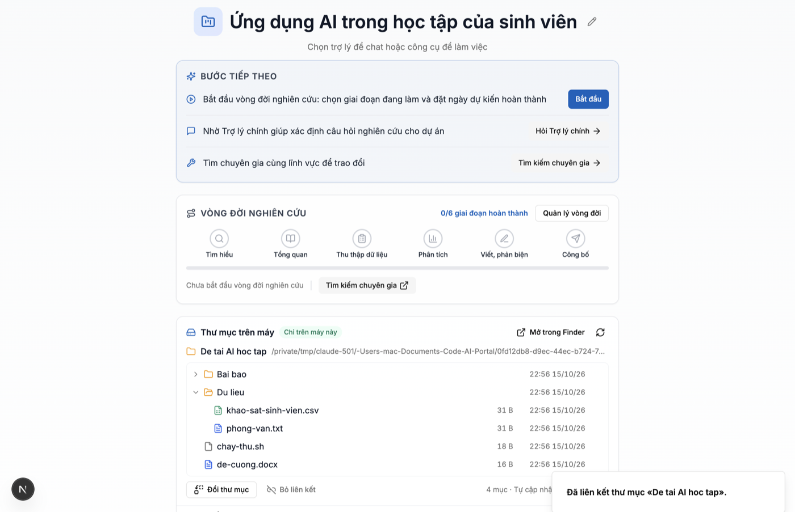

# NEU Research – ứng dụng máy tính (giai đoạn 1)

Ứng dụng Electron cho **Hệ thống hỗ trợ nghiên cứu khoa học dựa trên AI** của Đại học Kinh tế Quốc dân, chạy trên macOS và Windows.

Giai đoạn 1 gồm:

- **Vỏ ứng dụng:** cửa sổ hiển thị chính hệ thống web (mặc định https://research.neu.edu.vn). Phiên đăng nhập được giữ qua các lần mở app. Có menu tiếng Việt (đổi sang tiếng Anh được) và ghi nhớ kích thước, vị trí cửa sổ.
- **Thư mục dự án trên máy (chỉ đọc):** trên trang dự án, thẻ «Thư mục trên máy» cho phép liên kết dự án với một thư mục, xem cây tệp, mở tệp bằng ứng dụng mặc định và hiện tệp trong Finder/Explorer. Danh sách tự cập nhật khi tệp thay đổi. **Tệp không được tải lên máy chủ.**

Tầm nhìn (giai đoạn 2): mỗi dự án là một thư mục trên máy. Người dùng nhờ AI đọc và chỉnh sửa tệp trong thư mục đó, mọi thay đổi hiện dạng diff để người dùng duyệt trước khi ghi. Xem [Kế hoạch giai đoạn 2](#kế-hoạch-giai-đoạn-2).



---

## Chạy thử

Yêu cầu: Node.js 20 trở lên. Electron 44.6.0 được tải về khi chạy `npm install`.

```bash
cd desktop
npm install
npm start                  # build TypeScript rồi mở app, kết nối https://research.neu.edu.vn
npm run dev                # như start, có thêm mục «Công cụ nhà phát triển» và máy chủ localhost trong menu
npm run dev:local          # trỏ tới http://localhost:3000 (frontend AI-Portal chạy cục bộ)
```

Có ba cách đổi máy chủ, theo thứ tự ưu tiên:

1. `--portal-url=https://...` trên dòng lệnh
2. biến môi trường `NEU_PORTAL_URL`
3. trường `portalUrl` trong tệp cấu hình, hoặc chọn trong menu **Tệp → Máy chủ**

Máy chủ phải dùng https. Chỉ `localhost`, `127.0.0.1` và `[::1]` được phép dùng http. Hệ thống chạy dưới đường dẫn con, ví dụ `https://ai.neu.edu.vn/research`, cũng được hỗ trợ: app chỉ tin các trang nằm dưới `/research`.

Tệp cấu hình nằm trong thư mục dữ liệu của app:

- macOS: `~/Library/Application Support/NEU Research/neu-desktop-config.json`
- Windows: `%APPDATA%\NEU Research\neu-desktop-config.json`

### Kiểm thử

```bash
npm test                   # 27 kiểm thử đơn vị: chặn đường dẫn, chính sách điều hướng/quyền, thư mục dự án, theo dõi tệp
npm run test:e2e           # chạy Electron thật bằng Playwright với research.neu.edu.vn (không đăng nhập)
```

Kiểm thử thẻ «Thư mục trên máy» cần frontend chạy cục bộ với backend giả, không cần Postgres hay tài khoản:

```bash
node test/fixtures/mock-backend.mjs 3901 &
(cd ../frontend && BACKEND_URL=http://127.0.0.1:3901 npx next dev --webpack -p 3000) &
NEU_E2E_LOCAL=http://localhost:3000 node --test test/e2e/folder-card.e2e.test.mjs
```

Ghi chú về kiểm thử thẻ:

- Trang `/dev/desktop-folder` chỉ có ở môi trường phát triển (bản production trả 404). Trang này hiển thị màn hình dự án với dữ liệu giả.
- Nếu `frontend/node_modules` là symlink thì phải dùng `--webpack`, vì Turbopack từ chối symlink trỏ ra ngoài thư mục.
- Ở chế độ kiểm thử (`NEU_DESKTOP_E2E=1`, chỉ có hiệu lực khi chạy từ mã nguồn), app không mở trình duyệt hay Finder thật. Hộp thoại chọn thư mục lấy đường dẫn từ biến kiểm thử. Bản đóng gói bỏ qua các móc này.

### Đóng gói

```bash
npm run icons              # (khi đổi logo) tạo lại resources/icon.{png,icns,ico} từ frontend/public/NEU.svg
npm run dist:mac           # release/NEU-Research-<ver>-mac-arm64.dmg và -mac-x64.dmg
npm run dist:win           # release/NEU-Research-Setup-<ver>-win-x64.exe (NSIS, build được trên Mac)
```

Bản build **chưa ký số**:

- **macOS:** lần đầu mở, Gatekeeper báo «không thể xác minh nhà phát triển». Cách mở: chuột phải vào app → **Mở** → **Mở**. Với macOS 15 trở lên: mở **Cài đặt hệ thống → Quyền riêng tư & Bảo mật → «Vẫn mở»**. Cách khác: `xattr -dr com.apple.quarantine "/Applications/NEU Research.app"`.
- **Windows:** SmartScreen báo «Windows đã bảo vệ máy tính của bạn». Chọn **Thông tin thêm → Vẫn chạy**.

---

## Cấu trúc

```
desktop/
├── src/
│   ├── main/                 # tiến trình chính (Node)
│   │   ├── main.ts           # vòng đời app, cửa sổ, phiên, quyền, menu, gắn chính sách
│   │   ├── policy.ts         # hàm thuần: địa chỉ hệ thống, điều hướng, cửa sổ mới, quyền
│   │   ├── ipc.ts            # cầu nối IPC: kiểm tra người gửi, thư mục vừa chọn, theo dõi tệp
│   │   ├── projectFolders.ts # liên kết projectId ↔ thư mục, liệt kê, đọc tệp (giai đoạn 2 thêm ghi tại đây)
│   │   ├── pathGuard.ts      # chuẩn hoá và kiểm tra đường dẫn (chống `..`, đường dẫn tuyệt đối, symlink)
│   │   ├── fileTypes.ts      # tệp bỏ qua; tệp thực thi không cho mở
│   │   ├── watcher.ts        # fs.watch đệ quy + gom sự kiện
│   │   ├── config.ts         # cấu hình userData (ghi nguyên tử)
│   │   ├── menu.ts, i18n.ts  # menu vi/en
│   │   └── windowState.ts    # khôi phục cửa sổ trong màn hình còn tồn tại
│   ├── preload/preload.ts    # chạy trong sandbox, cấp window.neuDesktop
│   └── shared/api.ts         # hợp đồng API + tên kênh IPC
├── renderer/offline.*        # trang báo mất kết nối (file://, CSP chặt)
├── resources/icon.*          # biểu tượng (tạo bằng scripts/make-icons.cjs)
├── test/unit/                # node:test
├── test/e2e/                 # Playwright _electron
├── test/fixtures/            # backend giả cho kiểm thử thẻ
└── docs/screenshots/
```

Phía web (cùng nhánh):

- `frontend/lib/desktop-bridge.ts`: kiểu dữ liệu + `getDesktopBridge()` + điểm nối giai đoạn 2 `getLinkedFolderSnapshot()`.
- `frontend/components/desktop/local-folder-card.tsx`: thẻ «Thư mục trên máy», gắn vào `components/project-center-view.tsx`.
- `frontend/lib/i18n/locales/desktop.ts`: chuỗi vi/en.

### API `window.neuDesktop`

`isDesktop`, `version`, `platform`, `pickProjectFolder()`, `linkProjectFolder(projectId, path)`, `getLinkedFolder(projectId)`, `unlinkProjectFolder(projectId)`, `listFiles(projectId, subPath?)`, `readTextFile(projectId, relPath)`, `revealInFolder(projectId, relPath?)`, `openFile(projectId, relPath)`, `onFolderChange(projectId, cb) → huỷ`, `setActiveProject(projectId|null)`, `onMenuCommand(cb) → huỷ`.

Định nghĩa đầy đủ ở `src/shared/api.ts`. Bản sao kiểu ở `frontend/lib/desktop-bridge.ts`; khi đổi API phải sửa cả hai nơi.

Giới hạn hiện tại:

- tối đa 2.000 mục mỗi thư mục;
- đọc tối đa 1 MB mỗi tệp, phần thừa bị cắt (`truncated`); tệp nhị phân bị từ chối;
- bỏ qua tệp ẩn (`.*`), `node_modules`, `__pycache__`, `~$*` (tệp khoá Office).

---

## Mô hình bảo mật

1. **Cửa sổ web:**
   - `contextIsolation: true`, `nodeIntegration: false`, `sandbox: true` (bật cho toàn app bằng `app.enableSandbox()`), `webSecurity: true`;
   - không có `webviewTag`; `allowRunningInsecureContent: false`.

   Trang web không có `require` hay `process` (kiểm thử e2e xác nhận). Cửa sổ con cũng dùng đúng cấu hình này.
2. **Cầu nối chỉ cho đúng hệ thống:**
   - Preload chỉ gọi `exposeInMainWorld` khi khung chính có origin và basePath khớp địa chỉ đã cấu hình. Sang trang Microsoft hay trang khác thì `window.neuDesktop` không tồn tại (e2e xác nhận). Iframe (công cụ nhúng) không nhận được cầu nối.
   - Tiến trình chính kiểm tra lại **mọi** lệnh IPC: lệnh phải đến từ khung chính, của cửa sổ do app tạo, và URL hiện tại phải thuộc hệ thống.
3. **Đường dẫn:** trang web chỉ gửi đường dẫn tương đối. `pathGuard`:
   - từ chối đường dẫn tuyệt đối, ổ đĩa Windows, UNC, `~`, NUL, `:` (ADS) và `..`;
   - kiểm tra lại sau khi nối và sau khi phân giải symlink (realpath), nên symlink trỏ ra ngoài bị chặn;
   - với tệp chưa tồn tại (dùng cho giai đoạn 2), phân giải tổ tiên gần nhất.

   Có unit test cho từng trường hợp.
4. **Chỉ người dùng mới liên kết được thư mục:**
   - `linkProjectFolder` chỉ nhận đúng đường dẫn vừa được chọn trong hộp thoại của hệ điều hành, với cùng cửa sổ, trong vòng 10 phút và chỉ dùng được một lần.
   - Không liên kết được: gốc ổ đĩa, toàn bộ thư mục người dùng hoặc thư mục cha của nó, thư mục hệ thống (`/System`, `~/Library`, `C:\Windows`…).
   - Liên kết lưu trong `userData`, tách theo origin máy chủ.
5. **Không biến «mở tệp» thành «chạy chương trình»:**
   - `openFile` từ chối tệp thực thi và kịch bản: `.app .exe .bat .ps1 .sh .command .py .js .jar .lnk .url .webloc…`, tệp không đuôi có quyền thực thi, và thư mục.
   - Với những tệp này người dùng dùng «Hiện trong thư mục» rồi tự mở.
6. **Điều hướng:**
   - Trong cửa sổ chỉ được ở hệ thống và các máy chủ đăng nhập: `login.microsoftonline.com`, `login.microsoft.com`, `login.live.com`, `account.live.com` và **`sso.neu.edu.vn`** (NEU dùng Entra ID liên kết ADFS). Có thể thêm máy chủ qua `extraAuthHosts` trong cấu hình.
   - Liên kết http(s)/mailto khác mở bằng trình duyệt hoặc ứng dụng mặc định của máy.
   - `file:`, `javascript:`, `data:` và giao thức lạ bị chặn.
   - `window.open` tới trang hệ thống mở cửa sổ con an toàn; tới nơi khác thì mở bằng trình duyệt.
7. **Quyền:**
   - Chỉ trang hệ thống được cấp: ghi clipboard (nút «Sao chép»), toàn màn hình, **micro** (khung chat có nút nhập bằng giọng nói).
   - Từ chối: camera, vị trí, thông báo, MIDI, HID/USB/Serial…
   - Phiên mặc định (không dùng) từ chối mọi quyền.
   - Annota không ghi âm trực tiếp (chỉ tải tệp lên) nên không cần quyền gì thêm.
8. **Phiên đăng nhập:** cookie NextAuth nằm trong partition `persist:neu-research` và được mã hoá bằng khoá của hệ điều hành (fuse `EnableCookieEncryption`; macOS Keychain, Windows DPAPI). User-Agent bỏ chữ `Electron/` và thêm `NEUResearchDesktop/<ver>` để máy chủ nhận ra app.
9. **Electron Fuses (bản đóng gói):**
   - tắt `RunAsNode`, `NODE_OPTIONS`, `--inspect`;
   - bật kiểm tra toàn vẹn `app.asar` và chỉ nạp app từ asar;
   - tắt đặc quyền `file://`.
10. **Không có bí mật trong mã:** repo AI-Portal là công khai, app không chứa khoá hay token nào.

---

## Giới hạn và rủi ro hiện tại

- **Bản web đang chạy chưa có thay đổi frontend của nhánh này.** Trên research.neu.edu.vn đang có mục «Dự án trên máy» ở thanh bên, của bản desktop thử nghiệm cũ (12/10/2026, repo riêng `NEU-Research-Desktop`). Mục này gọi `getWorkspace()`, nên khi mở bằng app mới sẽ hiện thông báo lỗi «t.getWorkspace is not a function». Nhánh này đã sửa mục đó: chỉ hiện khi có API cũ. **Phải deploy frontend của nhánh này trước khi phát hành app.** Thẻ «Thư mục trên máy» cũng chỉ có trên web sau khi deploy.
- **Đăng nhập Microsoft:**
  - Đã kiểm tra tự động tới khi trang đăng nhập Microsoft hiện ra, ngay trong cửa sổ app (không bật cửa sổ phụ, không đẩy ra trình duyệt).
  - Bước ADFS `sso.neu.edu.vn` và callback về hệ thống **chưa thử bằng tài khoản thật**. Cần chủ hệ thống đăng nhập thử một lần.
  - Nếu NEU bật MFA hay chuyển hướng qua máy chủ khác chưa có trong danh sách, thêm máy chủ đó vào `extraAuthHosts`.
- **Nhập bằng giọng nói** trong khung chat dùng Web Speech API. Trong Electron, API này không có dịch vụ nhận dạng của Google nên nhiều khả năng không hoạt động. Muốn dùng được cần chuyển sang dịch vụ nhận dạng của hệ thống (ví dụ vspeech).
- **Liên kết thư mục tách theo máy chủ, chưa tách theo tài khoản.** Hai tài khoản NEU dùng chung một tài khoản hệ điều hành sẽ thấy liên kết của nhau (tệp vẫn ở máy đó). Giai đoạn 2 sẽ tách theo user id.
- Bản Windows đã build được trên Mac nhưng **chưa chạy thử trên máy Windows**.
- Thư mục trên ổ mạng có thể không phát sự kiện thay đổi. Khi đó dùng nút «Làm mới».
- Chưa có tự cập nhật (auto-update).

### Ký số, notarize, auto-update (chưa làm)

| Việc | Cần gì | Cách làm |
|---|---|---|
| Ký + notarize macOS | Apple Developer Program (99 USD/năm) của đơn vị; chứng chỉ **Developer ID Application**; Apple ID + app-specific password hoặc App Store Connect API key | Trong `package.json → build.mac`: bỏ `"identity": null`, thêm `"hardenedRuntime": true`, `"notarize": true`. Đặt biến `CSC_LINK`/`CSC_KEY_PASSWORD` (tệp .p12) và `APPLE_API_KEY`/`APPLE_API_KEY_ID`/`APPLE_API_ISSUER`. Lưu ý: khi ký thật, khoá cookie trong Keychain gắn với chữ ký mới nên người dùng có thể phải đăng nhập lại một lần. |
| Ký Windows | Chứng chỉ code signing (OV/EV; từ 2023 phải dùng token phần cứng hoặc ký trên đám mây như Azure Trusted Signing, DigiCert KeyLocker) | `build.win.signtoolOptions` hoặc `azureSignOptions`; ký trên CI Windows |
| Auto-update | Máy chủ phát hành (GitHub Releases của repo, hoặc thư mục tĩnh `https://research.neu.edu.vn/desktop/` chứa `latest.yml`/`latest-mac.yml`) | Thêm `electron-updater`, `build.publish`. macOS **bắt buộc đã ký** thì mới tự cập nhật được |
| CI | GitHub Actions: `macos-latest` (dmg) + `windows-latest` (nsis) | Chạy `npm test`, `npm run dist:*` và tải tệp lên Releases |

---

## Kế hoạch giai đoạn 2

### 1. Agent đọc và ghi tệp (trong main process)

Tất cả công cụ chạy ở tiến trình chính, dùng chung `ProjectFolderService` + `pathGuard`:

- `list(path, depth)`
- `read(path, range?)`
- `search(query, glob?)` (ripgrep đóng gói, hoặc tìm bằng JS)
- `stat`
- `proposeWrite(path, content)`, `proposeApplyPatch(unifiedDiff)`, `proposeRename`, `proposeDelete`

Nguyên tắc:

- **Không công cụ nào ghi thẳng.** Mỗi đề xuất tạo một bản ghi «thay đổi chờ duyệt».
- App hiện **diff** trong một cửa sổ nội bộ, có bản xem trước cho .docx/.xlsx (chuyển sang văn bản/bảng để so sánh). Người dùng **Chấp nhận / Từ chối từng tệp**.
- Chỉ khi chấp nhận mới gọi `applyChange()`:
  1. ghi tệp tạm rồi đổi tên (nguyên tử);
  2. trước khi ghi, kiểm tra mtime/hash: nếu tệp đã đổi từ lúc đề xuất thì báo xung đột.
- **Nhật ký và hoàn tác:** lưu bản gốc vào `<userData>/history/<projectId>/<thời gian>/`, kèm `journal.jsonl` (ai, khi nào, tệp nào, hash trước/sau). Có nút «Hoàn tác thay đổi này» và giới hạn dung lượng lịch sử.
- **Giới hạn:**
  - danh sách loại tệp được ghi: văn bản, mã phân tích (R/Python/Stata), CSV, Markdown, LaTeX, BibTeX; .docx/.xlsx qua thư viện;
  - không ghi tệp thực thi;
  - giới hạn kích thước;
  - bỏ qua `.git`.

  Trên API `window.neuDesktop` thêm `proposeChanges()` / `onChangeProposed()`. Trang web **không** có quyền tự áp dụng thay đổi: nút «Chấp nhận» nằm trong cửa sổ do main process vẽ.

### 2. Gọi LLM qua máy chủ Research bằng token của app

Hiện web dùng cookie NextAuth. App nên có token riêng, thu hồi được.

- **Cấp token:** `POST /api/desktop/token` (backend). Người dùng đang đăng nhập (cookie) bấm «Cho phép ứng dụng trên máy này». Backend tạo `desktop_tokens(id, user_id, device_name, hash(token), scopes, created_at, last_used_at, revoked_at)` và trả token **một lần**.
- **Truyền token về app:** chuyển hướng tới `neuresearch://auth?code=…` (custom protocol, PKCE). App đổi `code` lấy token ở `POST /api/desktop/token/exchange`.
- **Lưu token:** bằng `safeStorage` (Keychain/DPAPI), không bao giờ đưa vào trang web.
- **Phạm vi (scope):** `chat:central`, `projects:read`, `projects:sync`. Thời hạn 90 ngày, tự gia hạn khi dùng. Trang Hồ sơ có mục «Thiết bị đã đăng nhập» để thu hồi.
- **Gọi:** main process gọi `/api/chat` hoặc `/api/orchestrator` với `Authorization: Bearer`, có rate limit theo token.
- **Ngữ cảnh tệp:** ngữ cảnh gửi lên chỉ gồm phần người dùng cho phép, hiện rõ «sẽ gửi: tệp A (12 KB), B…». Điểm nối phía web là `getLinkedFolderSnapshot()` trong `frontend/lib/desktop-bridge.ts`.

### 3. Đồng bộ (tuỳ chọn, mặc định tắt)

- Bật theo từng dự án, kèm danh sách tệp/thư mục được đồng bộ.
- Tải lên kho lưu trữ dự án hiện có (`file_keys`) theo hash. Xung đột thì giữ cả hai bản.
- Không bao giờ tự đồng bộ ngược xuống ghi đè tệp trên máy.

### 4. Chạy phân tích cục bộ

- Phát hiện R/Python/Stata có trên máy. Chạy kịch bản do người dùng duyệt trong tiến trình con (`utilityProcess` hoặc `child_process` có giới hạn thời gian, thư mục làm việc = thư mục dự án), thu kết quả và đồ thị vào `outputs/`.
- Quantis/Annota chạy trong app đọc dữ liệu trực tiếp từ thư mục dự án qua cầu nối, không cần tải lên.
- Agent chỉ **đề xuất** lệnh chạy. Người dùng bấm chạy, và mọi tệp kết quả lại đi qua bước duyệt thay đổi.
