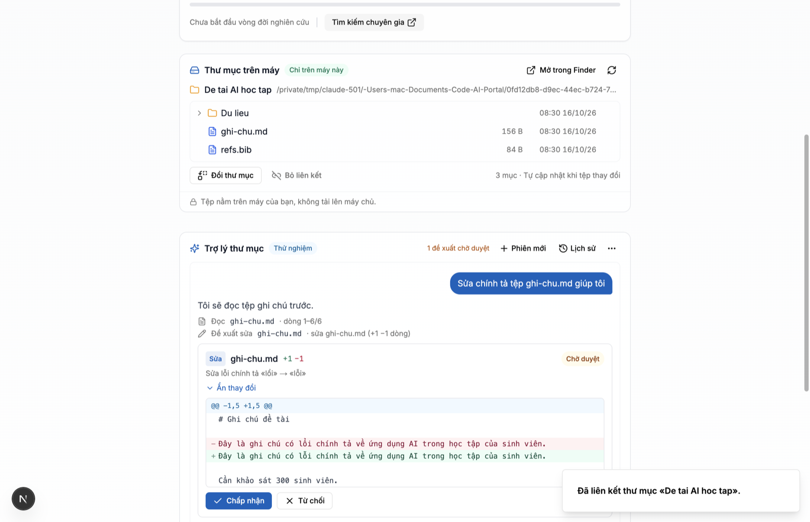

# NEU Research – ứng dụng máy tính (giai đoạn 2, bản 0.2.0)

Ứng dụng Electron cho **Hệ thống hỗ trợ nghiên cứu khoa học dựa trên AI** của Đại học Kinh tế Quốc dân, chạy trên macOS và Windows.

Tầm nhìn: mỗi dự án là một **thư mục trên máy** người dùng; người dùng nhờ AI đọc, tìm, tạo và chỉnh sửa tệp trong thư mục đó. Dữ liệu nằm trên máy; mô hình AI được gọi qua máy chủ Research (vLLM nội bộ), không gửi ra dịch vụ bên ngoài.

**Giai đoạn 1 (0.1.0):**

- **Vỏ ứng dụng:** cửa sổ hiển thị chính hệ thống web (mặc định https://research.neu.edu.vn). Phiên đăng nhập được giữ qua các lần mở app. Có menu tiếng Việt (đổi sang tiếng Anh được) và ghi nhớ kích thước, vị trí cửa sổ.
- **Thư mục dự án trên máy:** trên trang dự án, thẻ «Thư mục trên máy» cho phép liên kết dự án với một thư mục, xem cây tệp, mở tệp bằng ứng dụng mặc định và hiện tệp trong Finder/Explorer. Danh sách tự cập nhật khi tệp thay đổi. **Tệp không được tải lên máy chủ.**

**Giai đoạn 2 (0.2.0) — «Trợ lý thư mục»:**

- Khung chat ngay dưới thẻ «Thư mục trên máy» (chỉ hiện trong app, khi dự án đã liên kết thư mục). Trợ lý (agent) chạy ở **tiến trình chính** của app, dùng công cụ trong thư mục đã liên kết: liệt kê, đọc (văn bản thô, trích văn bản .docx/.xlsx/.pdf), tìm kiếm; tạo/sửa/đổi tên/xoá tệp **chỉ dưới dạng đề xuất**.
- Mỗi đề xuất hiện **diff (trước/sau)** với nút **Chấp nhận / Từ chối**; đã ghi thì có **Hoàn tác**. Bản gốc được sao lưu trong thư mục ẩn `.neu-research/history/` của dự án, kèm nhật ký `journal.jsonl`.
- App có **token riêng** (cấp khi người dùng đã đăng nhập web trong app, ngắn hạn + làm mới, thu hồi được), lưu bằng Keychain/DPAPI ở tiến trình chính; trang web không đọc được token.
- Lịch sử phiên trò chuyện lưu **cục bộ** (userData của app, tách theo máy chủ + tài khoản + dự án).
- Biểu tượng ứng dụng mới: bình thí nghiệm của thẻ «Nghiên cứu» (xem [Biểu tượng](#biểu-tượng-ứng-dụng)).



---

## Chạy thử

Yêu cầu: Node.js 20 trở lên. Electron 44.6.0 được tải về khi chạy `npm install`.

```bash
cd desktop
npm install
npm start                  # build TypeScript rồi mở app, kết nối https://research.neu.edu.vn
npm run dev                # như start, có thêm mục «Công cụ nhà phát triển» và máy chủ localhost trong menu
npm run dev:local          # trỏ tới http://localhost:3000 (frontend AI-Portal chạy cục bộ)
```

Có ba cách đổi máy chủ, theo thứ tự ưu tiên:

1. `--portal-url=https://...` trên dòng lệnh
2. biến môi trường `NEU_PORTAL_URL`
3. trường `portalUrl` trong tệp cấu hình, hoặc chọn trong menu **Tệp → Máy chủ**

Máy chủ phải dùng https. Chỉ `localhost`, `127.0.0.1` và `[::1]` được phép dùng http. Hệ thống chạy dưới đường dẫn con, ví dụ `https://ai.neu.edu.vn/research`, cũng được hỗ trợ: app chỉ tin các trang nằm dưới `/research`.

Tệp cấu hình nằm trong thư mục dữ liệu của app:

- macOS: `~/Library/Application Support/NEU Research/neu-desktop-config.json`
- Windows: `%APPDATA%\NEU Research\neu-desktop-config.json`

### Kiểm thử

```bash
npm test                   # 46 kiểm thử đơn vị (chạy bằng Node của Electron): chặn đường dẫn, chính sách, thư mục dự án,
                           # trợ lý: chính sách ghi, đề xuất/diff/chấp nhận/hoàn tác/xung đột, docx/xlsx/pdf, vòng lặp agent, token
npm run test:e2e           # chạy Electron thật bằng Playwright với research.neu.edu.vn (không đăng nhập)
```

Kiểm thử thẻ «Thư mục trên máy» cần frontend chạy cục bộ với backend giả, không cần Postgres hay tài khoản:

```bash
node test/fixtures/mock-backend.mjs 3901 &
(cd ../frontend && BACKEND_URL=http://127.0.0.1:3901 npx next dev --webpack -p 3000) &
NEU_E2E_LOCAL=http://localhost:3000 node --test test/e2e/folder-card.e2e.test.mjs
```

Ghi chú về kiểm thử thẻ:

- Trang `/dev/desktop-folder` chỉ có ở môi trường phát triển (bản production trả 404). Trang này hiển thị màn hình dự án với dữ liệu giả.
- Nếu `frontend/node_modules` là symlink thì phải dùng `--webpack`, vì Turbopack từ chối symlink trỏ ra ngoài thư mục.
- Ở chế độ kiểm thử (`NEU_DESKTOP_E2E=1`, chỉ có hiệu lực khi chạy từ mã nguồn), app không mở trình duyệt hay Finder thật. Hộp thoại chọn thư mục lấy đường dẫn từ biến kiểm thử. Bản đóng gói bỏ qua các móc này.

#### Kiểm thử trợ lý thư mục (đầu-cuối, không dùng DB/LLM thật)

Cần: Postgres tạm, backend + frontend của nhánh này chạy cục bộ, LLM giả lập kiểu OpenAI (`test/fixtures/mock-llm.mjs` trả `tool_calls` theo kịch bản).

1. Postgres tạm (ví dụ port 55432) → `createdb aiportal_e2e` → chạy `backend/migrations/001_create_enums.sql`, `backend/schema.sql`, rồi lần lượt các migration số (đến `025_desktop_tokens.sql`).
2. `app_settings`: `NEXTAUTH_SECRET` (giá trị ngẫu nhiên tạm), `central_llm_provider=openai_compatible`, `central_llm_base_url=http://127.0.0.1:3950/v1`, `central_llm_model=mock-qwen`, `default_locale=vi`, `public_locales=vi,en`. Thêm một tài khoản quản trị (để không vào màn hình cài đặt) và một tài khoản thử thường.
3. `BACKEND_ROOT=<thư mục tạm có data/setup-*.json và migrations>` `POSTGRES_HOST/PORT/...` `PORT=3911 NODE_ENV=development npx tsx src/server.ts` (trong `backend/`).
4. `node test/fixtures/mock-llm.mjs 3950` (đặt `MOCK_LLM_LOG=<tệp>` để ghi lại các yêu cầu, không có nội dung).
5. `BACKEND_URL=http://127.0.0.1:3911 NEXTAUTH_SECRET=<như trên> npx next dev --webpack -p 3000` (trong `frontend/`).
6. Tạo cookie phiên NextAuth cho tài khoản thử bằng `next-auth/jwt` `encode()` với secret tạm, rồi:

```bash
NEU_E2E_LOCAL=http://localhost:3000 NEU_E2E_SESSION_COOKIE=<jwt> node --test test/e2e/agent.e2e.test.mjs
```

Kịch bản: kết nối (tiến trình chính xin token bằng cookie, trang không thấy token, tệp token đã mã hoá) → «Sửa chính tả» → diff hiện ra, tệp chưa đổi → mã trên trang gọi thẳng `agentAcceptChange` khi người dùng không vừa bấm → bị từ chối → bấm Chấp nhận nhưng huỷ ở hộp thoại xác nhận → không ghi → Chấp nhận → ghi đúng, có bản sao trong `.neu-research/history` → Hoàn tác → khôi phục → phiên mới «Tạo dàn ý» → Từ chối → không có tệp → tóm tắt thư mục, mở lại phiên cũ sau khi tải lại trang → ngắt kết nối thiết bị.

Trong chế độ kiểm thử (`NEU_DESKTOP_E2E=1`, chỉ khi chạy từ mã nguồn) hộp thoại xác nhận ghi tệp đọc câu trả lời từ `globalThis.__neuConfirm` và Keychain được thay bằng kho khoá giả (`--use-mock-keychain`).

### Đóng gói

```bash
npm run icons              # (khi đổi biểu tượng) tạo lại resources/icon.{png,icns,ico} từ resources/icon-source.svg
npm run dist:mac           # release/NEU-Research-<ver>-mac-arm64.dmg và -mac-x64.dmg
npm run dist:win           # release/NEU-Research-Setup-<ver>-win-x64.exe (NSIS, build được trên Mac)
```

Bản build **chưa ký số**:

- **macOS — Keychain khi nâng cấp:** bản chưa ký dùng chữ ký ad-hoc, mỗi lần build có chữ ký khác. Máy đã cài 0.1.0 có sẵn mục Keychain «NEU Research Safe Storage» (khoá mã hoá cookie, nay dùng thêm cho token của trợ lý), nên khi mở 0.2.0 macOS hỏi mật khẩu đăng nhập máy: «NEU Research wants to use your confidential information stored in "NEU Research Safe Storage"». Người dùng nhập mật khẩu máy của mình và chọn **Always Allow** (Luôn cho phép). Chọn Deny thì app không giải mã được cookie cũ → phải đăng nhập lại. Hết hỏi khi app được ký bằng Developer ID cố định.
- **macOS:** lần đầu mở, Gatekeeper báo «không thể xác minh nhà phát triển». Cách mở: chuột phải vào app → **Mở** → **Mở**. Với macOS 15 trở lên: mở **Cài đặt hệ thống → Quyền riêng tư & Bảo mật → «Vẫn mở»**. Cách khác: `xattr -dr com.apple.quarantine "/Applications/NEU Research.app"`.
- **Windows:** SmartScreen báo «Windows đã bảo vệ máy tính của bạn». Chọn **Thông tin thêm → Vẫn chạy**.

Sau khi đóng gói, cập nhật `release/latest.json` (cùng định dạng tệp đang dùng cho trang tải về `https://research.neu.edu.vn/embed/launching/downloads/latest.json`): `version`, `date`, `channel`, `notes` (tiếng Việt), `files[]` gồm `name`, `os`, `arch`, `size`, `sha256`, `url`.

### Biểu tượng ứng dụng

Từ 0.2.0, biểu tượng là **bình thí nghiệm của thẻ «Nghiên cứu»** trên ai.neu.edu.vn, bản tối (nền `#00528C`, bình trắng, chất lỏng `#69A8CB`, bọt `#D6EEFB`).

- Nguồn chuẩn: repo **NEUAI**, `frontend/src/assets/keyvisual/neu-icons/dark/07-nghien-cuu-binh-thi-nghiem.svg` (bản sáng ở `.../light/`). Bản sao để đối chiếu: `resources/icon-src/neuai-07-nghien-cuu-binh-thi-nghiem-dark.svg`.
- `resources/icon-source.svg`: cùng hình, đặt vào khuôn icon macOS (khung 1024, ô bo góc 824 px, bo 185 px, lề trong suốt 100 px). `npm run icons` vẽ tệp này thành `icon.png` (1024, có bóng nhẹ), `icon.icns` (macOS, qua `iconutil`) và `icon.ico` (Windows, 16–256 px, cắt sát ô bo góc).
- Đã kiểm tra trên bản 0.2.0 đóng gói: biểu tượng hiện đúng trong Dock ([ảnh](docs/screenshots/12-bieu-tuong-dock-0.2.0.png)).
- Đổi biểu tượng: dựng lại `icon-source.svg` từ tệp chuẩn của NEUAI (giữ nguyên hình và màu), chạy `npm run icons`, rồi đóng gói lại.
- Không dùng thư mục `build/` cho tệp nguồn: `.gitignore` gốc của repo bỏ qua mọi thư mục tên `build`.

---

## Cấu trúc

```
desktop/
├── src/
│   ├── main/                 # tiến trình chính (Node)
│   │   ├── main.ts           # vòng đời app, cửa sổ, phiên, quyền, menu, gắn chính sách
│   │   ├── policy.ts         # hàm thuần: địa chỉ hệ thống, điều hướng, cửa sổ mới, quyền
│   │   ├── ipc.ts            # cầu nối IPC: kiểm tra người gửi, thư mục vừa chọn, theo dõi tệp
│   │   ├── projectFolders.ts # liên kết projectId ↔ thư mục, liệt kê, đọc tệp
│   │   ├── pathGuard.ts      # chuẩn hoá và kiểm tra đường dẫn (chống `..`, đường dẫn tuyệt đối, symlink)
│   │   ├── fileTypes.ts      # tệp bỏ qua; tệp thực thi không cho mở
│   │   ├── watcher.ts        # fs.watch đệ quy + gom sự kiện
│   │   ├── config.ts         # cấu hình userData (ghi nguyên tử)
│   │   ├── menu.ts, i18n.ts  # menu vi/en
│   │   ├── windowState.ts    # khôi phục cửa sổ trong màn hình còn tồn tại
│   │   ├── auth.ts           # GĐ2: token của app (xin bằng cookie web, safeStorage, làm mới, thu hồi)
│   │   ├── agentIpc.ts       # GĐ2: IPC trợ lý; xác nhận ghi bằng hộp thoại hệ điều hành
│   │   └── agent/
│   │       ├── agent.ts      # vòng lặp tool-calling, giới hạn bước/token/thời gian, rút gọn ngữ cảnh
│   │       ├── tools.ts      # list_files, read_file, search_text + đề xuất write/edit/rename/delete
│   │       ├── changes.ts    # đề xuất → diff → chấp nhận (sao lưu, ghi nguyên tử) / từ chối / hoàn tác
│   │       ├── writePolicy.ts# đuôi tệp được ghi, giới hạn
│   │       ├── docx.ts       # đọc/sửa/tạo .docx, trích .xlsx (fflate)
│   │       ├── extract.ts    # đọc văn bản, trích .pdf (unpdf/pdf.js)
│   │       ├── llmClient.ts  # gọi POST /api/desktop/chat (SSE)
│   │       └── sessions.ts   # lịch sử phiên cục bộ
│   ├── preload/preload.ts    # chạy trong sandbox, cấp window.neuDesktop
│   └── shared/api.ts         # hợp đồng API + tên kênh IPC
├── renderer/offline.*        # trang báo mất kết nối (file://, CSP chặt)
├── resources/icon.*          # biểu tượng (tạo bằng scripts/make-icons.cjs từ resources/icon-source.svg)
├── test/unit/                # node:test
├── test/e2e/                 # Playwright _electron
├── test/fixtures/            # backend giả cho kiểm thử thẻ; mock-llm.mjs (LLM giả lập kiểu OpenAI)
└── docs/screenshots/
```

Phía web (cùng nhánh):

- `frontend/lib/desktop-bridge.ts`: kiểu dữ liệu + `getDesktopBridge()` + điểm nối giai đoạn 2 `getLinkedFolderSnapshot()`.
- `frontend/components/desktop/local-folder-card.tsx`: thẻ «Thư mục trên máy», gắn vào `components/project-center-view.tsx`.
- `frontend/components/desktop/folder-assistant-panel.tsx`: khung «Trợ lý thư mục» (GĐ2), hiển thị dưới thẻ khi đã liên kết và app có API trợ lý (`getDesktopAgentBridge()`); app 0.1.0 vẫn chỉ thấy thẻ.
- `frontend/lib/i18n/locales/desktop.ts`: chuỗi vi/en.

### API `window.neuDesktop`

`isDesktop`, `version`, `platform`, `pickProjectFolder()`, `linkProjectFolder(projectId, path)`, `getLinkedFolder(projectId)`, `unlinkProjectFolder(projectId)`, `listFiles(projectId, subPath?)`, `readTextFile(projectId, relPath)`, `revealInFolder(projectId, relPath?)`, `openFile(projectId, relPath)`, `onFolderChange(projectId, cb) → huỷ`, `setActiveProject(projectId|null)`, `onMenuCommand(cb) → huỷ`.

Giai đoạn 2: `agentGetStatus()`, `agentConnect()`, `agentDisconnect()`, `agentListSessions(projectId)`, `agentGetSession(projectId, sessionId)`, `agentDeleteSession(…)`, `agentSend(projectId, sessionId|null, text) → {runId, sessionId}`, `agentStop(runId)`, `onAgentEvent(cb) → huỷ`, `agentListChanges(projectId, sessionId?)`, `agentAcceptChange(projectId, changeId)`, `agentRejectChange(…)`, `agentUndoChange(…)`. **Không có** hàm ghi tệp trực tiếp; không hàm nào trả token.

Định nghĩa đầy đủ ở `src/shared/api.ts`. Bản sao kiểu ở `frontend/lib/desktop-bridge.ts`; khi đổi API phải sửa cả hai nơi.

Giới hạn hiện tại:

- tối đa 2.000 mục mỗi thư mục;
- đọc tối đa 1 MB mỗi tệp, phần thừa bị cắt (`truncated`); tệp nhị phân bị từ chối;
- bỏ qua tệp ẩn (`.*`), `node_modules`, `__pycache__`, `~$*` (tệp khoá Office).

---

## Mô hình bảo mật

1. **Cửa sổ web:**
   - `contextIsolation: true`, `nodeIntegration: false`, `sandbox: true` (bật cho toàn app bằng `app.enableSandbox()`), `webSecurity: true`;
   - không có `webviewTag`; `allowRunningInsecureContent: false`.

   Trang web không có `require` hay `process` (kiểm thử e2e xác nhận). Cửa sổ con cũng dùng đúng cấu hình này.
2. **Cầu nối chỉ cho đúng hệ thống:**
   - Preload chỉ gọi `exposeInMainWorld` khi khung chính có origin và basePath khớp địa chỉ đã cấu hình. Sang trang Microsoft hay trang khác thì `window.neuDesktop` không tồn tại (e2e xác nhận). Iframe (công cụ nhúng) không nhận được cầu nối.
   - Tiến trình chính kiểm tra lại **mọi** lệnh IPC: lệnh phải đến từ khung chính, của cửa sổ do app tạo, và URL hiện tại phải thuộc hệ thống.
3. **Đường dẫn:** trang web chỉ gửi đường dẫn tương đối. `pathGuard`:
   - từ chối đường dẫn tuyệt đối, ổ đĩa Windows, UNC, `~`, NUL, `:` (ADS) và `..`;
   - kiểm tra lại sau khi nối và sau khi phân giải symlink (realpath), nên symlink trỏ ra ngoài bị chặn;
   - với tệp chưa tồn tại (dùng cho giai đoạn 2), phân giải tổ tiên gần nhất.

   Có unit test cho từng trường hợp.
4. **Chỉ người dùng mới liên kết được thư mục:**
   - `linkProjectFolder` chỉ nhận đúng đường dẫn vừa được chọn trong hộp thoại của hệ điều hành, với cùng cửa sổ, trong vòng 10 phút và chỉ dùng được một lần.
   - Không liên kết được: gốc ổ đĩa, toàn bộ thư mục người dùng hoặc thư mục cha của nó, thư mục hệ thống (`/System`, `~/Library`, `C:\Windows`…).
   - Liên kết lưu trong `userData`, tách theo origin máy chủ.
5. **Không biến «mở tệp» thành «chạy chương trình»:**
   - `openFile` từ chối tệp thực thi và kịch bản: `.app .exe .bat .ps1 .sh .command .py .js .jar .lnk .url .webloc…`, tệp không đuôi có quyền thực thi, và thư mục.
   - Với những tệp này người dùng dùng «Hiện trong thư mục» rồi tự mở.
6. **Điều hướng:**
   - Trong cửa sổ chỉ được ở hệ thống và các máy chủ đăng nhập: `login.microsoftonline.com`, `login.microsoft.com`, `login.live.com`, `account.live.com` và **`sso.neu.edu.vn`** (NEU dùng Entra ID liên kết ADFS). Có thể thêm máy chủ qua `extraAuthHosts` trong cấu hình.
   - Liên kết http(s)/mailto khác mở bằng trình duyệt hoặc ứng dụng mặc định của máy.
   - `file:`, `javascript:`, `data:` và giao thức lạ bị chặn.
   - `window.open` tới trang hệ thống mở cửa sổ con an toàn; tới nơi khác thì mở bằng trình duyệt.
7. **Quyền:**
   - Chỉ trang hệ thống được cấp: ghi clipboard (nút «Sao chép»), toàn màn hình, **micro** (khung chat có nút nhập bằng giọng nói).
   - Từ chối: camera, vị trí, thông báo, MIDI, HID/USB/Serial…
   - Phiên mặc định (không dùng) từ chối mọi quyền.
   - Annota không ghi âm trực tiếp (chỉ tải tệp lên) nên không cần quyền gì thêm.
8. **Phiên đăng nhập:** cookie NextAuth nằm trong partition `persist:neu-research` và được mã hoá bằng khoá của hệ điều hành (fuse `EnableCookieEncryption`; macOS Keychain, Windows DPAPI). User-Agent bỏ chữ `Electron/` và thêm `NEUResearchDesktop/<ver>` để máy chủ nhận ra app.
9. **Electron Fuses (bản đóng gói):**
   - tắt `RunAsNode`, `NODE_OPTIONS`, `--inspect`;
   - bật kiểm tra toàn vẹn `app.asar` và chỉ nạp app từ asar;
   - tắt đặc quyền `file://`.
10. **Không có bí mật trong mã:** repo AI-Portal là công khai, app không chứa khoá hay token nào.

---

11. **Token của app (GĐ2):**
    - Xin token: tiến trình chính gọi `POST /api/desktop/token` bằng `session.fetch` của partition app (mang cookie đăng nhập web) + header `X-NEU-Desktop-Client: 1` (header lạ ⇒ trình duyệt khác origin phải preflight và bị CORS chặn; cookie NextAuth là SameSite=Lax). Token trả về cho tiến trình chính, **không đi qua trang web**.
    - Lưu bằng `safeStorage` (macOS Keychain, Windows DPAPI) trong `neu-desktop-auth.json` (quyền 600), tách theo máy chủ. Máy không có kho khoá (Linux thiếu keyring) thì chỉ giữ trong bộ nhớ.
    - Máy chủ chỉ lưu **SHA-256** của token. Access token 1 giờ, refresh token 30 ngày **xoay vòng**; dùng lại refresh token cũ ⇒ thu hồi cả phiên thiết bị; hạn tuyệt đối 180 ngày; tối đa 10 thiết bị/người (vượt thì thu hồi phiên cũ nhất).
    - Tài khoản khách / hệ thống (`guest@portal.local`, `system@portal.local`, `guest-…@local`, `…@portal.local`) **không được cấp**.
    - Thu hồi: menu «… → Ngắt kết nối thiết bị này» (app gọi `/token/revoke`), hoặc người dùng đăng nhập web gọi `DELETE /api/desktop/devices/:id` (chưa có giao diện web).
    - Giới hạn đã biết: mã chạy trên chính trang hệ thống (nếu bị XSS) có cookie đăng nhập nên cũng có thể tự gọi `/api/desktop/token` để lấy một token (phạm vi chỉ là chat của app, thu hồi được, hiện trong danh sách thiết bị) — tương đương quyền mà cookie đã có.
12. **Trợ lý thư mục (GĐ2):**
    - Agent chạy ở tiến trình chính; công cụ chỉ thao tác trong thư mục đã liên kết, dùng chung `pathGuard` (chặn `..`, đường dẫn tuyệt đối, symlink ra ngoài — kể cả khi ghi tệp mới và khi ghi vào `.neu-research/history`).
    - **Không có công cụ chạy lệnh/chương trình** và không truy cập Internet.
    - **Không công cụ nào ghi thẳng**: tạo/sửa/đổi tên/xoá đều thành đề xuất chờ duyệt.
    - Chỉ ghi được tệp `.txt .md .markdown .rst .org .adoc .csv .tsv .json .yaml .yml .xml .tex .bib .ris .nbib .enw .log .docx`. Chặn ghi mọi tệp thực thi/kịch bản/mã (`.sh .py .R .js .exe .command .app …`), tệp không đuôi, tệp/thư mục ẩn (`.git`, `.neu-research`), `node_modules`, `~$…`, tên thiết bị Windows. Không đổi tên sang/từ tệp thực thi. Tệp ghi ra không bao giờ có quyền thực thi.
    - **Chấp nhận / Hoàn tác** cần hai lớp: (1) preload chỉ gửi lệnh khi trang có *user activation* (người dùng vừa bấm/gõ thật — mã tự động chạy sau đó vài giây bị từ chối); (2) tiến trình chính hiện **hộp thoại xác nhận của hệ điều hành** (trang web không vẽ được). Người dùng có thể tick «Không hỏi lại cho dự án này cho tới khi đóng ứng dụng» — khi đó chỉ còn lớp (1).
    - Khi ghi: kiểm tra lại đường dẫn + chính sách; so **băm tệp hiện tại** với lúc đề xuất (khác ⇒ «xung đột», không ghi); sao lưu bản gốc; ghi tệp tạm cùng thư mục rồi đổi tên (nguyên tử); giữ kiểu xuống dòng CRLF/BOM. Hoàn tác chỉ chạy khi tệp vẫn đúng như lúc trợ lý ghi; bản trợ lý đã ghi cũng được giữ (`history/<id>/after`).
    - Giới hạn mỗi lượt: 12 bước gọi mô hình, 8 công cụ/bước, 20 đề xuất, 200.000 token, 10 phút; đọc tối đa 16.000 ký tự/lần (đọc tiếp theo dòng), tệp văn bản 2 MB, docx/xlsx/pdf 25 MB; ghi tối đa 1 triệu ký tự; tìm kiếm tối đa 2.000 tệp/80 kết quả/8 giây. Người dùng bấm **Dừng** bất cứ lúc nào.
    - Ngữ cảnh gửi lên luôn được rút gọn cho vừa mô hình 32k token (kết quả công cụ của lượt cũ bị cắt, lượt quá cũ bị bỏ; máy chủ báo 413 thì rút gọn mạnh hơn và thử lại một lần).
    - Máy chủ **không lưu** nội dung hội thoại hay nội dung tệp; chỉ ghi `ai_portal.desktop_usage` (người dùng, thiết bị, thời điểm, model, trạng thái, số token, số ký tự đầu vào, số lời gọi công cụ, thời gian).

## Triển khai giai đoạn 2 (máy chủ)

App 0.2.0 vẫn chạy được với máy chủ cũ (thẻ «Thư mục trên máy» như 0.1.0); khung «Trợ lý thư mục» chỉ hiện và hoạt động sau khi deploy backend + frontend của nhánh này.

**Backend** (`backend/src/routes/desktop.ts`, mount `/api/desktop`):

| Endpoint | Xác thực | Việc |
|---|---|---|
| `POST /api/desktop/token` | cookie NextAuth + header `X-NEU-Desktop-Client: 1` | cấp access + refresh token (201); khách → 403, chưa đăng nhập → 401 |
| `POST /api/desktop/token/refresh` | body `{refresh_token}` | xoay vòng cặp token |
| `POST /api/desktop/token/revoke` | Bearer access hoặc body `{refresh_token}` | app tự ngắt kết nối |
| `GET /api/desktop/devices`, `DELETE /api/desktop/devices/:id` | cookie | người dùng xem/thu hồi thiết bị của chính mình |
| `GET /api/desktop/me` | Bearer | tài khoản, model, giới hạn, token đã dùng 24 giờ |
| `POST /api/desktop/chat` | Bearer | stream SSE tới LLM của Central (`getCentralLlmCredentials()`: base URL, model, `extraHeaders` kiểu Kong `x-ollama-seckey`; tắt thinking bằng `llmExtraBody`), có `tools`/`tool_calls` |

- **Migration:** `backend/migrations/025_desktop_tokens.sql` (bảng `ai_portal.desktop_tokens`, `ai_portal.desktop_usage`). Runner tự chạy khi khởi động; ngoài ra backend tự `CREATE TABLE IF NOT EXISTS` bằng chính tệp này khi dùng lần đầu (phòng trùng số với nhánh khác). Không đụng bảng cũ.
- **Frontend:** `next.config.mjs` thêm `desktop` vào danh sách rewrite `/api/*` → backend. Đường SSE đi qua rewrite của Next (đã có `proxyTimeout` 180 giây) và nginx (`X-Accel-Buffering: no`).
- **Không cần khoá mới.** LLM dùng cấu hình Central sẵn có trong `app_settings` (vLLM `/vllm/v1`, `qwen3.5-35b-a3b-int4`). Không hard-code khoá trong mã.
- **Biến môi trường tuỳ chọn** (mặc định trong ngoặc): `DESKTOP_ACCESS_TTL_SEC` (3600), `DESKTOP_REFRESH_TTL_SEC` (2592000), `DESKTOP_ABSOLUTE_TTL_SEC` (15552000), `DESKTOP_MAX_DEVICES` (10), `DESKTOP_CHAT_RATE_PER_MIN` (30 yêu cầu/phút/người), `DESKTOP_CHAT_MAX_CONCURRENT` (2), `DESKTOP_DAILY_TOKEN_LIMIT` (1.500.000 token/24 giờ/người; 0 = không giới hạn), `DESKTOP_CHAT_MAX_BODY_BYTES` (1.500.000), `DESKTOP_CHAT_MAX_INPUT_CHARS` (80.000), `DESKTOP_CHAT_MAX_MESSAGES` (120), `DESKTOP_CHAT_MAX_TOOLS` (16), `DESKTOP_CHAT_MAX_OUTPUT_TOKENS` (4096), `DESKTOP_CONTEXT_TOKENS` (32768). `/api/desktop/chat` còn chịu giới hạn theo IP của lớp `ai-guard` (`AI_CORE_RATE_LIMIT`, thân JSON 6 MB).
- Giới hạn theo người dùng (số yêu cầu/phút, luồng đồng thời) giữ trong bộ nhớ của tiến trình backend: chạy nhiều bản backend thì mỗi bản đếm riêng.

## Giới hạn và rủi ro hiện tại

- **Phải deploy backend + frontend của nhánh này** thì trợ lý mới chạy. Trước đó app 0.2.0 vẫn dùng được như 0.1.0. (Lưu ý cũ vẫn đúng: bản web đang chạy có mục «Dự án trên máy» của bản thử nghiệm 12/10, gọi `getWorkspace()` → phải deploy frontend mới để hết thông báo lỗi.)
- **Chưa thử với vLLM thật** từ máy phát triển (không có khoá Kong ở máy này); luồng đã kiểm bằng LLM giả lập kiểu OpenAI. Qwen3.5 trên vLLM có lúc không gọi công cụ ổn định (đã gặp ở Central); backend có đường dự phòng tách `<tool_call>{…}</tool_call>` trong nội dung khi server không bật tool parser. Cần chủ hệ thống thử vài lượt sau khi deploy.
- **Chi phí ngữ cảnh:** mỗi bước của agent gửi lại toàn bộ ngữ cảnh đã rút gọn (≈ tối đa 20k token). Một lượt sửa tệp thường 3–5 bước. Theo dõi `ai_portal.desktop_usage` và chỉnh `DESKTOP_DAILY_TOKEN_LIMIT` nếu cần.
- **.docx:** chỉ sửa được cụm văn bản nằm trong một đoạn (không chứa tab/ngắt dòng của Word); không sửa đầu trang/chân trang/chú thích/hộp văn bản; tạo .docx mới chỉ có tiêu đề + đoạn văn thường. Ghi đè cả tệp .docx đã có bị chặn (để không mất định dạng). **.pdf/.xlsx chỉ đọc**; PDF quét ảnh (không có lớp chữ) không đọc được.
- **Chưa có giao diện web «Thiết bị đã kết nối»** (API đã có: `GET/DELETE /api/desktop/devices`).
- Thông điệp công cụ/lỗi phía tiến trình chính chỉ có tiếng Việt (nhãn giao diện có vi/en).
- **Đăng nhập Microsoft:** đã kiểm tra tới trang đăng nhập Microsoft trong cửa sổ app; bước ADFS `sso.neu.edu.vn` và callback **chưa thử bằng tài khoản thật**. Nếu có máy chủ đăng nhập khác, thêm vào `extraAuthHosts`.
- **Nhập bằng giọng nói** (Web Speech API) nhiều khả năng không hoạt động trong Electron.
- **Liên kết thư mục tách theo máy chủ, chưa tách theo tài khoản** (lịch sử phiên và đề xuất của trợ lý thì đã tách theo tài khoản).
- Bản Windows build trên Mac, **chưa chạy thử trên máy Windows** (đường dẫn `C:\…`, DPAPI, tệp đang mở trong Word bị khoá → trợ lý báo «tệp đang mở trong ứng dụng khác»).
- Thư mục trên ổ mạng có thể không phát sự kiện thay đổi; dùng nút «Làm mới».
- Chưa ký số, chưa có tự cập nhật.

### Ký số, notarize, auto-update (chưa làm)

| Việc | Cần gì | Cách làm |
|---|---|---|
| Ký + notarize macOS | Apple Developer Program (99 USD/năm) của đơn vị; chứng chỉ **Developer ID Application**; Apple ID + app-specific password hoặc App Store Connect API key | Trong `package.json → build.mac`: bỏ `"identity": null`, thêm `"hardenedRuntime": true`, `"notarize": true`. Đặt biến `CSC_LINK`/`CSC_KEY_PASSWORD` (tệp .p12) và `APPLE_API_KEY`/`APPLE_API_KEY_ID`/`APPLE_API_ISSUER`. Lưu ý: khi ký thật, khoá cookie trong Keychain gắn với chữ ký mới nên người dùng có thể phải đăng nhập lại một lần. |
| Ký Windows | Chứng chỉ code signing (OV/EV; từ 2023 phải dùng token phần cứng hoặc ký trên đám mây như Azure Trusted Signing, DigiCert KeyLocker) | `build.win.signtoolOptions` hoặc `azureSignOptions`; ký trên CI Windows |
| Auto-update | Máy chủ phát hành (GitHub Releases của repo, hoặc thư mục tĩnh `https://research.neu.edu.vn/desktop/` chứa `latest.yml`/`latest-mac.yml`) | Thêm `electron-updater`, `build.publish`. macOS **bắt buộc đã ký** thì mới tự cập nhật được |
| CI | GitHub Actions: `macos-latest` (dmg) + `windows-latest` (nsis) | Chạy `npm test`, `npm run dist:*` và tải tệp lên Releases |

---

## Việc tiếp theo (giai đoạn 3, đề xuất)

1. **Giao diện «Thiết bị đã kết nối»** trong trang Hồ sơ (dùng `GET/DELETE /api/desktop/devices`).
2. **Cho phép ghi mã phân tích (.R/.py/.do) có duyệt** và **chạy phân tích cục bộ**: phát hiện R/Python/Stata, chạy kịch bản người dùng duyệt trong tiến trình con có giới hạn thời gian, thư mục làm việc = thư mục dự án; kết quả lại đi qua bước duyệt thay đổi. Agent chỉ đề xuất lệnh, người dùng bấm chạy.
3. **Xem trước .docx/.xlsx dạng bảng** trong diff; sửa đầu trang/chú thích Word.
4. **Đồng bộ (tuỳ chọn, mặc định tắt)** lên kho lưu trữ dự án theo hash, xung đột giữ cả hai bản, không bao giờ tự ghi đè tệp trên máy.
5. **Ký số + notarize macOS, ký Windows, auto-update** (bảng ở trên).
6. Tách liên kết thư mục theo tài khoản.
